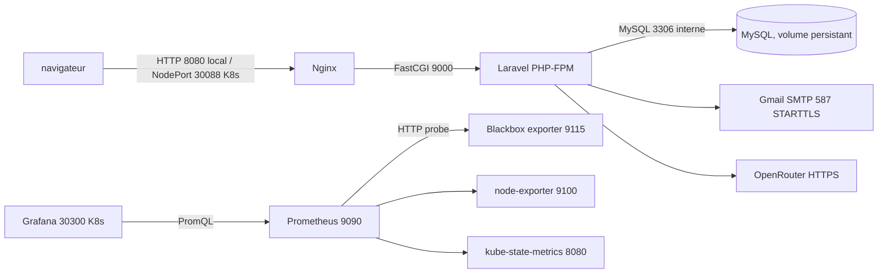

# Stack DevOps préparée pour NEXORA

Ce dossier ajoute des exemples versionnables pour une exécution locale ou un futur staging. Les fichiers ne sont pas une preuve qu'un moteur Docker, Jenkins, Kubernetes ou SonarQube Cloud a été lancé. Les ressources Secrets sont volontairement vides. Aucun accès distant ni déploiement n'est effectué par cette préparation.

## Architecture et ports



| Composant | Port interne | Accès local prévu | Persistance |
| --- | ---: | ---: | --- |
| Nginx | 80 | `http://localhost:8080` | Code image, uploads partagés |
| PHP-FPM | 9000 | privé au réseau Compose/Kubernetes | `storage` |
| MySQL | 3306 | `127.0.0.1:3307` en Compose | volume nommé/PVC |
| Prometheus | 9090 | service cluster | `emptyDir` (données perdues au redémarrage) |
| Grafana | 3000 | NodePort 30300 en K8s | configuration provisionnée, pas de PVC |
| node-exporter | 9100 | métriques cluster | sans état |
| blackbox-exporter | 9115 | métriques cluster | configuration ConfigMap |
| kube-state-metrics | 8080 | métriques cluster | lecture API Kubernetes |

Les manifests Kubernetes visent le namespace `nexora` et un namespace séparé `nexora-monitoring`. La configuration utilise `solarshare` comme nom de base, cohérent avec l'environnement local connu; elle n'embarque aucune donnée locale. Le StatefulSet prépare un nouveau MySQL sur son PVC. Il ne se connecte pas à la base historique XAMPP.

## Prérequis externes

- Docker Desktop avec Docker Compose v2, PHP 8.3/Composer 2 et Node.js 22/npm si les contrôles locaux natifs sont souhaités.
- Pour Jenkins : agent Linux avec PHP 8.3, Composer, Node 22, npm; Docker uniquement pour le stage image sur `main`; plugin Pipeline et JUnit.
- Pour SonarQube Cloud : projet créé, `sonar.projectKey`/organisation réels, scanner compatible, credentials Jenkins `sonarcloud-token` et `sonarcloud-organization`. Le stage est désactivé par défaut avec `RUN_SONAR=false`.
- Pour Kubernetes : cluster, `kubectl` et Kustomize, registry accessible, images construites et poussées par l'opérateur; stockage `ReadWriteMany` pour l'application, PVC `ReadWriteOnce` pour MySQL.
- Gmail SMTP et OpenRouter exigent des secrets réels provisionnés par l'opérateur. Ne pas les mettre dans Git, ConfigMaps ou commandes enregistrées dans l'historique.

## Développement Docker Compose

Le fichier `.env` local fournit déjà les valeurs de l'application; Compose les transmet au conteneur Laravel. Il faut ajouter localement `DB_ROOT_PASSWORD` si elle manque et garder `DB_PASSWORD`, `DB_DATABASE` et `DB_USERNAME` cohérents. Ne réutilisez pas les identifiants d'une base de production.

```powershell
docker compose config --quiet
docker compose build
docker compose up -d
docker compose ps
docker compose logs --tail 100 app nginx mysql
```

Ouvrir `http://localhost:8080`. L'instance MySQL isolée du Compose est accessible depuis l'hôte sur `127.0.0.1:3307`. Au premier démarrage, créez le schéma de cette instance locale uniquement, après avoir vérifié la cible :

```powershell
docker compose exec app php artisan migrate --force
docker compose exec app php artisan route:list
docker compose exec app php artisan about
```

Les volumes nommés `mysql_data` et `app_storage` persistent après `docker compose down`. Ne lancez pas `docker compose down -v` si vous souhaitez garder ces données. Le bind mount `public/uploads` est local. Une livraison staging doit utiliser des sauvegardes et une procédure de migration approuvée.

## Jenkins et SonarQube Cloud

Jenkins exécute `Jenkinsfile`: checkout, versions outils, install Composer verrouillée, validation/audit, Pint, tests PHPUnit avec JUnit, build Vite, puis un build Docker local sur `main`. Il ne pousse pas l'image. Le pipeline requiert Linux (`sh`) et les outils cités; un agent Windows PowerShell n'est pas compatible sans adaptation.

Pour Sonar : remplacez la clé projet d'exemple `nexora-laravel` par celle du projet Sonar réel, configurez les credentials Jenkins indiqués et lancez le paramètre `RUN_SONAR`. Le rapport JUnit est le rapport de tests; aucun rapport de couverture n'est configuré ou fabriqué. Le scan n'a pas été exécuté ici.

## Kubernetes

1. Construire deux images à partir de `Dockerfile` et `docker/nginx/Dockerfile`, puis les pousser vers le registre choisi. Modifier les références `nexora-app:local` et `nexora-nginx:local` dans `k8s/app.yaml` et `k8s/nginx.yaml` pour les tags immuables réellement poussés.
2. Créer `nexora-secrets` dans le namespace `nexora` via un gestionnaire externe ou un mécanisme d'injection de secrets. Clés requises : `APP_KEY`, `DB_PASSWORD`, `DB_ROOT_PASSWORD`, `MAIL_USERNAME`, `MAIL_PASSWORD`, `MAIL_FROM_ADDRESS`, `OPENROUTER_API_KEY`.
3. Créer `grafana-secrets` dans `nexora-monitoring` avec `admin-password` injecté hors Git.
4. Vérifier que la StorageClass permet les deux PVC RWX de `app-storage` et `app-uploads`.
5. Relire toutes les ressources et leur capacité avant application. N'exécutez les commandes ci-dessous que sur un cluster explicitement choisi et vide/adapté à cette stack.

```powershell
kubectl config current-context
kubectl kustomize k8s
kubectl kustomize k8s/monitoring
kubectl apply -k k8s
kubectl apply -k k8s/monitoring
kubectl -n nexora rollout status deployment/app
kubectl -n nexora rollout status deployment/nginx
kubectl -n nexora rollout status statefulset/mysql
kubectl -n nexora get pods,svc,pvc
kubectl -n nexora-monitoring get pods,svc
```

Ne pas copier la base XAMPP dans ce nouveau MySQL sans procédure de sauvegarde, import et validation distincte. Les exemples n'appliquent pas de migration automatiquement. Vérifiez d'abord `kubectl config current-context`; aucun `apply`/déploiement n'a été effectué durant la mission.

## Vérification locale du projet Laravel

Depuis PowerShell Windows normal, à la racine du dépôt :

```powershell
php artisan test
php artisan test --filter=AiAssistantsTest
vendor\bin\pint --test
npm ci
npm run build
php artisan route:cache
php artisan route:clear
php artisan view:cache
php artisan migrate:status
```

Dans un terminal où PHP signale `is_readable() = false` pour des fichiers pourtant lisibles par Windows, le résultat PHPUnit n'est pas représentatif. Utilisez un PowerShell Windows non sandboxé et contrôlez `php --version` et `Get-Command php`.

## Dépannage

- **Compose ne démarre pas** : `docker compose config` puis `docker compose logs mysql app nginx`; vérifier les variables localement sans coller leur contenu dans un ticket.
- **Connexion DB refusée** : dans Compose, l'hôte Laravel est `mysql:3306`, jamais `127.0.0.1`; depuis Windows, utiliser `127.0.0.1:3307`.
- **MySQL reste unhealthy** : vérifier les variables DB locales et `docker compose ps`; le volume nommé persiste son initialisation.
- **Fichiers refusés en K8s** : vérifier les PVC, permissions UID/GID PHP-FPM et que le fournisseur supporte RWX.
- **Image K8s introuvable** : construire/pousser les tags et vérifier `imagePullSecrets` si le registre est privé.
- **Gmail** : port 587 avec STARTTLS, mot de passe d'application configuré localement et certificats TLS activés. Consulter `CONFIGURATION_EMAIL_GMAIL.md`.
- **OpenRouter HTTP 429** : attendre le quota/rate limit du modèle gratuit puis retenter une campagne courte; ne pas boucler automatiquement.
- **Sonar indisponible** : vérifier projet/org, token Jenkins et scanner sur l'agent; ne jamais afficher le token.
- **Monitoring** : Prometheus conserve actuellement ses données dans `emptyDir`; ajouter un PVC avant usage de longue durée. Grafana et Prometheus ne sont pas exposés publiquement hormis le NodePort Grafana prévu.

## État de validation de cette stack

Les manifests, scripts et noms de ports ont été relus statiquement. Pendant cette mission, Docker/Compose, kubectl/Kustomize, Jenkins et sonar-scanner n'étaient pas disponibles dans le PATH. Aucune image n'a été construite, aucune syntaxe n'a été validée par ces moteurs, aucun cluster ou serveur n'a été contacté et aucun tableau de bord n'a été observé. Traitez ces ressources comme une préparation à valider sur les outils/cibles correspondants.
