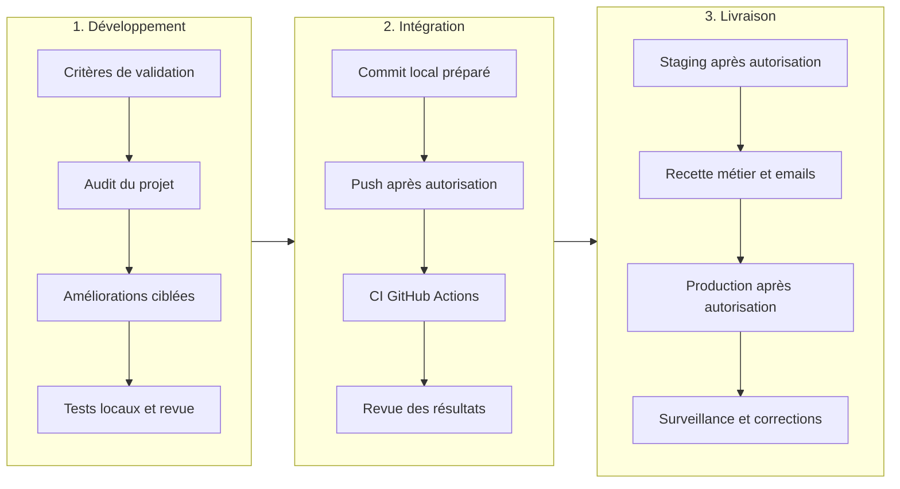
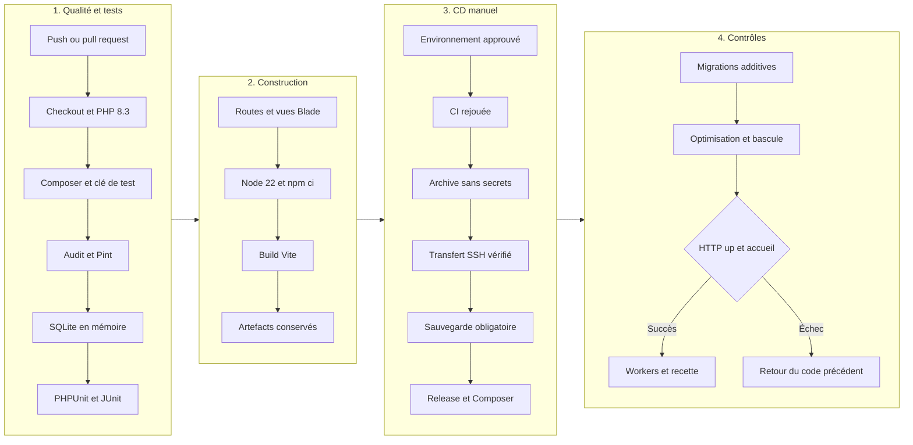

# SolarShare — Dossier DevOps de validation finale

> **Actualisation du 30 octobre 2026 :** 27 tests / 181 assertions réussis, 70 contrôles HTTP et 13 contrôles supplémentaires SMTP/2FA réussis. Mailpit 1.32.0 est installé et démarré sur les interfaces locales uniquement ; deux notifications ont été réellement reçues et leurs liens vérifiés. Les workflows ont passé actionlint 1.7.12, sans ShellCheck/Pyflakes ; le script a passé `bash -n`. La clé OpenRouter reste absente : aucun résultat IA réel n’est revendiqué. Le commit local est préparé séparément de tout push. Aucun run GitHub ni déploiement effectué.

**Module :** Applications Web Avancées — ESPRIT
**Échéance :** semaine du 2 novembre 2026
**État de préparation :** 30 octobre 2026, fuseau Africa/Tunis

## 1. Présentation et objectifs

SolarShare permet de consulter et louer des équipements d’énergie renouvelable, suivre des réclamations, participer à des événements et lire des articles. Le projet existant est conservé : Laravel 12, PHP, MySQL, Eloquent, Blade, Creative/Bootstrap pour le Front Office et AdminLTE pour le Back Office. Les cinq modules restent séparés dans `routes/modules/` et dans leurs vues et hooks de navigation.

Le processus DevOps vise des livraisons reproductibles, des régressions détectées avant déploiement, la protection des données et des secrets et une preuve vérifiable des contrôles. Un pipeline préparé n’est pas assimilé à un pipeline exécuté sur GitHub ni à un déploiement réel.

## 2. Outils et responsabilités

| Outil | Usage |
| --- | --- |
| Git / GitHub Actions | Versionnement, CI sur push et pull request, CD sur déclenchement manuel |
| PHP 8.3 / Laravel 12 | Application et commandes Artisan |
| Composer et `composer.lock` | Installation PHP reproductible et audit de vulnérabilités |
| PHPUnit 11 | Tests fonctionnels, validations, permissions et intégrations simulées |
| Laravel Pint | Contrôle automatique du style PHP |
| SQLite en mémoire | Base éphémère exclusivement réservée aux tests |
| MySQL / InnoDB | Base applicative ; transactions et verrous métier |
| Node.js 22 / npm / Vite | Installation verrouillée et compilation frontend en CI |
| OpenRouter / client HTTP Laravel | Service IA commun aux cinq modules |
| Google2FA / BaconQrCode | TOTP, vérification anti-réutilisation et QR code SVG généré localement |
| SSH / Nginx / PHP-FPM | Cible Linux paramétrable pour le déploiement |

Les changements et la préparation du commit restent locaux. Aucun push, envoi à l’enseignant ou déploiement en production n’a été effectué. Le dépôt distant est configuré ; son utilisation en écriture et l’exécution de GitHub Actions restent soumises à l’autorisation du propriétaire.

## 3. Processus DevOps



## 4. Pipeline CI/CD



### CI : `.github/workflows/ci.yml`

1. Récupérer le code avec des permissions de lecture uniquement.
2. Préparer PHP 8.3, Composer et les extensions SQLite/MySQL, XMLWriter, cURL, DOM, mbstring et fileinfo.
3. Copier `.env.example` et préparer les répertoires de cache. Les variables du job remplacent les réglages MySQL par SQLite en mémoire.
4. Installer exactement le verrou Composer, générer une clé de test et exécuter `composer validate --strict`, `composer audit` et `vendor/bin/pint --test`.
5. Exécuter les migrations sur une connexion SQLite en mémoire. Cette commande vérifie le schéma ; sa base disparaît à la fin du processus. PHPUnit recrée ensuite son propre schéma éphémère.
6. Exécuter la suite et produire `storage/test-results.xml`. Le fichier JUnit est téléversé même en cas d’échec.
7. Vérifier la mise en cache des routes et la compilation de toutes les vues Blade.
8. Préparer Node 22, exécuter `npm ci`, compiler avec Vite et conserver `public/build` comme artefact.

Un échec bloque les étapes suivantes et le CD. Les appels IA sont simulés : aucun secret OpenRouter n’est nécessaire en CI.

### CD : `.github/workflows/cd.yml` et `scripts/deploy.sh`

Le déploiement est volontairement manuel (`workflow_dispatch`) et dépend d’une nouvelle exécution de la CI. Il cible `staging` ou `production`, avec un environnement GitHub à configurer et des approbateurs pour la production. Il n’est pas activé automatiquement par un push.

Le pipeline récupère les assets compilés, construit une archive sans `.env`, données, uploads, cache local ni dépendances de développement et vérifie l’identité SSH du serveur avec `SSH_KNOWN_HOSTS`. Les paramètres sont validés avant utilisation. Sur le serveur, un verrou `flock` évite les livraisons concurrentes. Le programme local `shared/backup-before-deploy` doit réussir avant toute migration.

Une release séparée reçoit le code. Les données, uploads et `.env` restent dans `shared/`. Composer installe les dépendances de production, puis Artisan crée le lien du stockage, applique les migrations avec `--force --isolated=75` et optimise l’application. Le code 75 fait échouer la livraison si le verrou de migration n’est pas obtenu. Un lien symbolique `current` est remplacé atomiquement. Le script contrôle `/up` et l’accueil ; un échec après bascule restaure le lien du code précédent, s’il existe.

**Limites du retour arrière :** les migrations ne sont jamais annulées automatiquement. Toutes les migrations d’une livraison doivent rester compatibles avec la version précédente. Restaurer une base nécessite une procédure séparée, une sauvegarde vérifiée et une décision explicite. Une première livraison ne possède pas de code précédent à restaurer.

## 5. Stratégie de tests et protection des données

Les tests fonctionnels vérifient : inscription sans élévation de rôle, lien email signé, réinitialisation à token expirant et à usage unique, permissions, profil et suppression du compte, activation et désactivation TOTP, anti-réutilisation et récupération, catalogue et comparateur, réservations et chevauchements, calcul serveur des montants, capacité des événements, favoris privés, historique et pièces jointes autorisées, plafonnement des paiements, les cinq assistants IA, erreurs API et validation administrative explicite.

`tests/TestCase.php` refuse de démarrer les migrations de test si la configuration est en cache, si la base n’est pas SQLite en mémoire ou si une URL de connexion est définie. `phpunit.xml` configure les sessions et le cache en mémoire ainsi que le transport email de test. Aucun `migrate:fresh` n’a été lancé sur la base de développement. Le trait Laravel `RefreshDatabase` ne reconstruit que la base de test en mémoire après ce contrôle.

Les verrous `lockForUpdate` ont été ajoutés aux services de réservation, participation et paiement. Les tests séquentiels vérifient les règles métier ; ils ne constituent pas un test de charge ni une preuve de concurrence réelle sous MySQL. Une recette avec deux sessions simultanées sur staging reste nécessaire.

Les tests de l’IA utilisent `Http::fake` et empêchent les requêtes imprévues. Ils ne prouvent ni la disponibilité ni la qualité d’un modèle gratuit à un instant donné. L’assistant refuse les identifiants d’équipement absents du catalogue candidat et ne crée aucune réservation. Le catalogue envoyé est limité aux 40 candidats les moins chers admissibles. Les sélecteurs administratifs présentent les 100 derniers contenus.

## 6. Configuration des services externes

### Emails et authentification

Le transport principal a été configuré automatiquement vers Mailpit : `MAIL_MAILER=smtp`, schéma SMTP, hôte `127.0.0.1`, port `1025`, sans identifiant. L’interface Mailpit est liée à `127.0.0.1:8025`. Son binaire officiel et sa base de messages sont dans le stockage privé ignoré par Git. Aucun relais externe n’est configuré. Le cache Laravel a été vidé après modification ; aucune clé API n’a été modifiée.

Deux messages ont été reçus par SMTP pour un nouveau compte fictif : vérification d’adresse et réinitialisation du mot de passe. Le lien signé a marqué l’adresse vérifiée ; le lien de réinitialisation a permis une nouvelle connexion avec le nouveau mot de passe. Les métadonnées non sensibles et les 13 contrôles associés sont consignés dans `docs/resultats-smtp-2fa.json`. Les tokens et codes ne sont pas inclus. Cela valide une réception locale dans Mailpit, pas la livraison sur Internet.

Vérifier `APP_URL` : il sert à générer les liens signés et les liens de réinitialisation. La recette isolée utilise `http://127.0.0.1:8010`, tandis que l’instance principale conserve son URL habituelle. Les comptes existants non vérifiés doivent passer par `/verifier-email`. Aucun compte historique n’a été modifié ; l’adresse fictive a été vérifiée en ouvrant le lien réellement reçu.

### OpenRouter

Dans le `.env` privé uniquement :

```dotenv
OPENROUTER_API_KEY=<clé privée à renseigner localement>
OPENROUTER_MODEL=openrouter/free
```

La clé n’était pas configurée lors des contrôles. Aucun appel IA réel n’a été effectué. Le service utilise un délai de connexion de 5 secondes, un délai total de 30 secondes, une réponse JSON contrôlée et des limites de 5 requêtes par minute et de 100 par jour par utilisateur. Les interruptions, erreurs de quota et réponses invalides produisent un message français ; aucune réponse simulée n’est présentée comme réelle dans l’application.

Les formulaires informent de l’envoi à OpenRouter. Seuls les besoins et les champs utiles du contenu sont transmis ; les identités liées, paiements et pièces jointes sont exclus. Les textes saisis peuvent néanmoins contenir des informations personnelles : les utilisateurs doivent les retirer avant envoi. Les résultats sont échappés dans Blade. Les contenus proposés pour les réclamations, événements et articles ne sont enregistrés qu’après une action explicite de l’administrateur.

## 7. Préparer la cible Linux

Installer PHP 8.3 avec les extensions requises, Composer 2, MySQL/InnoDB, Nginx, PHP-FPM, curl, tar, util-linux/flock et un client de sauvegarde. Configurer HTTPS. Utiliser un compte de déploiement dédié ; le processus web doit écrire uniquement dans le stockage partagé et `bootstrap/cache`.

Arborescence attendue :

```text
/srv/solarshare/
  current -> releases/<identifiant>
  releases/
  shared/
    .env
    storage/       # app/private, app/public, framework/cache, framework/views, framework/sessions, logs
    uploads/       # fichiers historiques de public/uploads
    backup-before-deploy
```

Créer ces répertoires, transférer les fichiers historiques et préparer `.env` sur le serveur avant le premier CD. `backup-before-deploy` doit sauvegarder MySQL et les données partagées hors du dossier des releases, vérifier la réussite et conserver une trace horodatée. Les identifiants MySQL de sauvegarde doivent rester dans un fichier de configuration protégé, pas dans la ligne de commande ni dans GitHub Actions. Tester une restauration en staging.

Configurer notamment `APP_ENV=production`, `APP_DEBUG=false`, `APP_URL=https://...`, une `APP_KEY` stable, les accès MySQL, `SESSION_SECURE_COOKIE=true`, `SESSION_HTTP_ONLY=true`, `SESSION_SAME_SITE=lax`, le transport SMTP et la clé IA. Ne jamais regénérer `APP_KEY` sur une instance existante : les secrets TOTP sont chiffrés avec cette clé. Le serveur doit maintenir son heure synchronisée pour le TOTP.

Adapter `docs/nginx.conf.example`. La racine doit être `current/public`, avec interdiction d’exécuter des scripts dans les uploads. Les anciennes pièces jointes sous `public/uploads/reclamations` sont refusées en accès direct et servies via le contrôleur authentifié. Les nouveaux fichiers sont privés dans `storage/app/private/reclamations`. Apache reçoit les mêmes protections dans `public/.htaccess` ; le serveur PHP de développement ne lit pas `.htaccess` et ne remplace pas ces protections en production.

Préparer un service de workers supervisé et le planificateur Laravel si des traitements différés sont activés. Le script demande un redémarrage des workers, mais ne crée pas lui-même le service système.

Dans chaque environnement GitHub, renseigner les secrets `SSH_HOST`, `SSH_USER`, `SSH_PORT`, `SSH_PRIVATE_KEY`, `SSH_KNOWN_HOSTS`, puis les variables `DEPLOY_ROOT` (par exemple `/srv/solarshare`) et `HEALTH_URL` (URL HTTPS sans slash final). La clé hôte doit être obtenue par un canal de confiance, pas acceptée aveuglément pendant la livraison. Restreindre les branches autorisées et activer les approbateurs de production avant utilisation.

## 8. Reproduire les contrôles localement

Prérequis : PHP 8.3, Composer, extensions SQLite/XMLWriter, Node 22 conseillé (le build local a aussi réussi sous Node 20.19.6).

```bash
composer install
composer validate --strict
composer audit
php artisan config:clear
php vendor/bin/pint --test
php artisan test --compact
php artisan route:cache
php artisan route:clear
php artisan view:cache
npm ci
npm run build
git diff --check
bash -n scripts/deploy.sh
```

`config:clear` efface uniquement le cache de configuration ; il ne modifie pas les données. Ne pas copier un `.env` de production pour lancer les tests. Pour installer les nouvelles tables sur une autre instance, sauvegarder sa base, vérifier `migrate:status` et exécuter uniquement les migrations en attente avec `php artisan migrate`. Aucun seeding n’est nécessaire pour mettre à jour une instance existante. La migration additive a déjà été exécutée sur l’instance locale de ce workspace ; ne pas la rejouer manuellement en SQL.

Pour vérifier GitHub Actions, pousser seulement après autorisation du propriétaire, ouvrir l’onglet Actions, contrôler chaque étape et télécharger le rapport JUnit et l’artefact `solarshare-assets`. Pour le CD, préparer staging et ses secrets, choisir le workflow manuel et valider d’abord la sauvegarde et les contrôles HTTP. Un badge vert local ne remplace pas cette exécution distante.

## 9. Résultats obtenus et recette restante

| Vérification | Résultat réellement constaté |
| --- | --- |
| PHPUnit | 27 tests réussis, 181 assertions lors de la dernière exécution |
| Recette HTTP | 70 contrôles réels sur base SQLite séparée, plus 13 contrôles SMTP/2FA |
| Migration MySQL locale | Nouvelle migration additive exécutée, batch 4 ; anciennes migrations conservées |
| Photos de profil | Lien `public/storage` créé |
| Composer | Configuration valide ; mise à jour ciblée de `symfony/mime` 7.4.19 vers 7.4.22 ; aucun avis de vulnérabilité après mise à jour |
| Frontend | Installation npm et build Vite réussis ; audit npm sans vulnérabilité à l’installation |
| Routes et vues | Mise en cache des routes puis suppression du cache réussies ; compilation Blade réussie |
| Bash | Syntaxe de `scripts/deploy.sh` vérifiée avec Git Bash |
| Pint | Formatage appliqué ; `pint --test` réussi |
| Navigateur local | Accueil, comparaison réelle de deux équipements, connexion admin de démonstration, profil, assistant administratif, calendrier, estimation à 44 DT sur deux jours et déconnexion contrôlés en vue étroite |
| SMTP local | Deux messages reçus dans Mailpit ; vérification d’adresse et réinitialisation réellement réussies |
| 2FA réelle | Activation, QR local, confirmation, challenge TOTP, récupération à usage unique et désactivation rejoués avec succès |
| IA réelle | Non exécutée : clé OpenRouter absente pour les cinq modules ; modèle `openrouter/free` confirmé |
| CI GitHub | Fichiers préparés ; aucune exécution distante revendiquée |
| CD réel | Non exécuté ; cible, secrets, sauvegarde et autorisation à fournir |

Avant soutenance : renseigner la clé IA localement et effectuer une demande réelle par module, vérifier le scan physique du QR code avec une application TOTP, les écritures concurrentes MySQL et le CD en staging. Le téléchargement privé et les deux formats navigateur ont été contrôlés ; la réception locale SMTP est maintenant vérifiée. Mailpit doit rester démarré pendant la présentation. Ne pas utiliser les mots de passe de démonstration historiques sur un hébergement public.

## 10. Références techniques

- [Déploiement et contrôles de santé Laravel 12](https://laravel.com/docs/12.x/deployment)
- [Configuration PHP dans GitHub Actions](https://github.com/shivammathur/setup-php)
- [Google2FA et QR codes](https://github.com/antonioribeiro/google2fa)
- [API de complétion OpenRouter](https://openrouter.ai/docs/api/api-reference/chat/send-chat-completion-request)

Le PDF `docs/DEVOPS_VALIDATION_FINALE.pdf` est généré depuis ce document par `scripts/generate_devops_pdf.py`, avec ReportLab et le moteur Mermaid réel. Les deux diagrammes sont présentés sur des pages paysage et les pages sont numérotées. Les pages rendues en images ont été contrôlées avant livraison. Aucun envoi à l’enseignant n’a été effectué.
